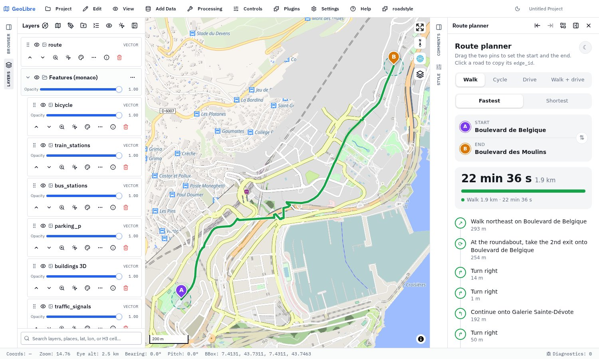
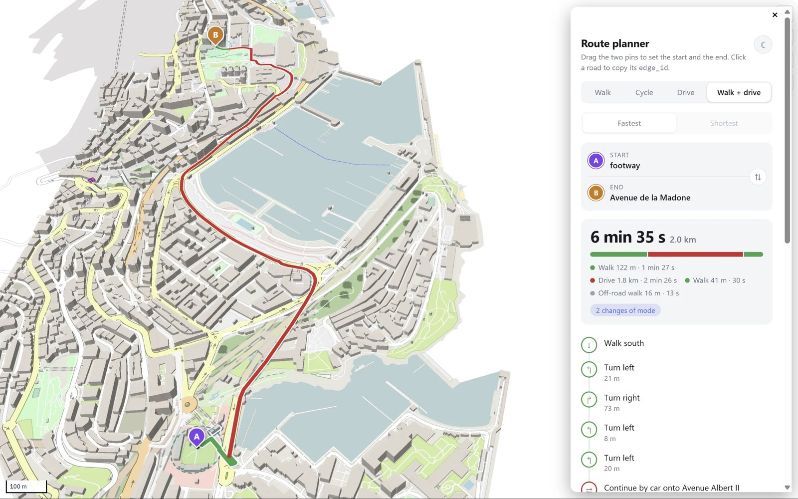

  
  &nbsp;&nbsp;
  <a href="https://github.com/Khoshkhah/duckOSM"><picture>
    <source media="(prefers-color-scheme: dark)" srcset="docs/img/duckosm-inverse.svg">
    
  </picture></a>
  &nbsp;&nbsp;
  

<h1 align="center">roadstyle plugin for GeoLibre</h1>

  Roads in <a href="https://github.com/Khoshkhah/roadstyle">roadstyle</a>'s look, from a <a href="https://github.com/Khoshkhah/duckOSM">duckOSM</a> database, in <a href="https://web.geolibre.app">GeoLibre</a>. 
  
  

The plugin draws roads with casings, bridges, tunnels and one-way arrows, with 3D buildings and base-map layers, over GeoLibre's own map. The map
is made in the browser from a duckOSM database or a style file. No server is needed.

> ## Download: [roadstyle-geolibre.zip](https://github.com/Khoshkhah/geolibre-roadstyle/releases/latest/download/roadstyle-geolibre.zip) (version 0.20.0)
>
> 1. In GeoLibre: **Settings › Manage Plugins › Settings › Install from file**. Choose the `.zip`.
> 2. **Plugins › Installed › roadstyle** makes the plugin active.
> 3. The menu **roadstyle** is at the end of the top bar.

## What it does

- **Draws roads in [roadstyle](https://github.com/Khoshkhah/roadstyle)'s look**: casings, bridges, tunnels, one-way arrows, street names, 3D buildings, and a switch for each road type.
- **A route planner**: drop a start and an end on the map and get the route, with the time, the length and the steps (Walk, Cycle, Drive, Walk + drive).
- **Opens a [duckOSM](https://github.com/Khoshkhah/duckOSM) database in the browser** (a `.duckdb` file), or a style file that [mapstyle](https://github.com/Khoshkhah/mapstyle) made. No server.

## Try it with Monaco

1. Download [monaco.duckdb](https://github.com/Khoshkhah/duckOSM/releases/download/v0.6.0/monaco.duckdb) (38 MB).
2. Menu **roadstyle › Open a duckOSM database…**, choose the file, then **Open**.
3. The map is on the screen after about 18 seconds (the plugin runs Python in the browser). The street names and arrows follow. The same file opens again in about 3 seconds.

## Route planner

**Where it comes from.** The route planner is duckOSM's (`duckosm route-map`). duckOSM turns OpenStreetMap into a routable network and keeps it in the `.duckdb` file:
for each mode (driving, walking, cycling) the roads and the turns that are allowed, and the links between walking and driving. The plugin reads this network
from the file and finds the route in your browser, with turn-by-turn steps, using the same code and the same panel as `duckosm route-map`.

- Drag the pins **A** and **B**. The route changes at once.
- Close the panel (×) to go back to the normal map. **roadstyle › Route planner** opens it again.
- In full screen, the panel is a box over the map:

## Your own data

| You have | Do this |
|---|---|
| A duckOSM `.duckdb` file | **roadstyle › Open a duckOSM database…** |
| A style file (fast: opens in about 1 second) | `mapstyle area.duckdb --inline area.json --planner`, then **roadstyle › Add a roadstyle layer…** |
| A style URL | **roadstyle › Add a roadstyle layer…**, or the link `https://web.geolibre.app/?roadstyle=<URL>` |
| A data layer with duckOSM columns | **roadstyle › Style a layer with roadstyle…** |

To make a `.duckdb` file: `pip install duckosm`, then `duckosm build --config area.yaml` ([duckOSM](https://github.com/Khoshkhah/duckOSM)).

## More

[The guide](docs/guide.md): the Layers panel, the dialog choices, the input data in detail, what the plugin needs, how to build and test it.
Made with [roadstyle](https://github.com/Khoshkhah/roadstyle), [mapstyle](https://github.com/Khoshkhah/mapstyle) and [duckOSM](https://github.com/Khoshkhah/duckOSM), for [GeoLibre](https://github.com/opengeos/geolibre) (MIT license; the GeoLibre logo is its icon
[docs/assets/geolibre-icon.png](https://github.com/opengeos/GeoLibre/blob/9cf193094e6575bfd152ec020345a8e69b75290c/docs/assets/geolibre-icon.png)).
