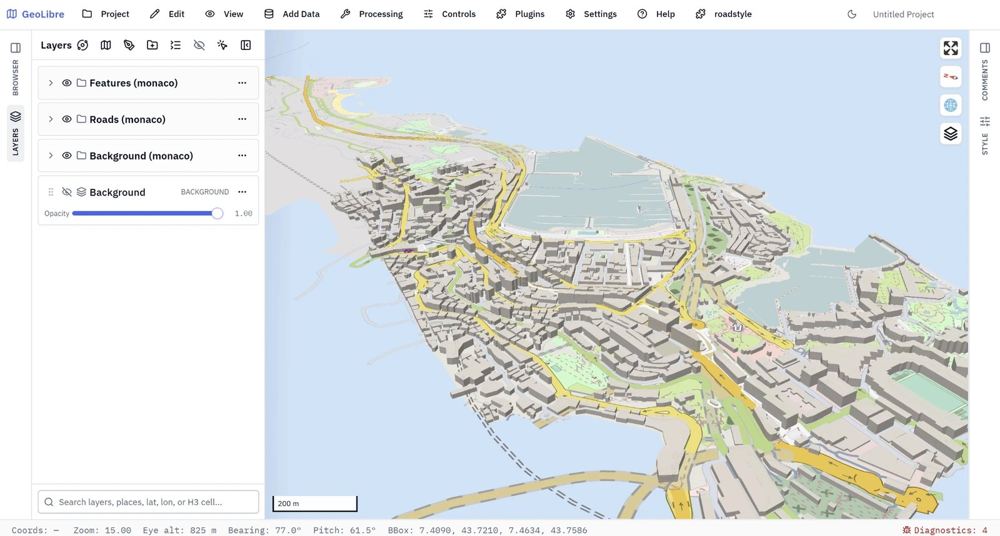

<p align="center">
  <a href="https://github.com/Khoshkhah/roadstyle"></a>
  &nbsp;&nbsp;
  <a href="https://github.com/Khoshkhah/duckOSM"><picture>
    <source media="(prefers-color-scheme: dark)" srcset="docs/img/duckosm-inverse.svg">
    
  </picture></a>
  &nbsp;&nbsp;
  <a href="https://web.geolibre.app"></a>
</p>

<h1 align="center">roadstyle plugin for GeoLibre</h1>

<p align="center">
  Roads in <a href="https://github.com/Khoshkhah/roadstyle">roadstyle</a>'s look, from a <a href="https://github.com/Khoshkhah/duckOSM">duckOSM</a> database, in <a href="https://web.geolibre.app">GeoLibre</a>.<br>
  <a href="https://github.com/Khoshkhah/geolibre-roadstyle/releases/latest"></a>
  
</p>

<p align="center"></p>

The plugin draws roads with casings, bridges, tunnels and one-way arrows, with 3D buildings and base-map layers, over GeoLibre's own map. The map
is made in the browser from a duckOSM database or a style file. No server is needed.

> ## Download: [roadstyle-geolibre.zip](https://github.com/Khoshkhah/geolibre-roadstyle/releases/latest/download/roadstyle-geolibre.zip) (version 0.19.0)
>
> 1. In GeoLibre: **Settings › Manage Plugins › Settings › Install from file**. Choose the `.zip`.
> 2. **Plugins › Installed › roadstyle** makes the plugin active.
> 3. The menu **roadstyle** is at the end of the top bar.

## Try it with Monaco

1. Download the finished database: [monaco.duckdb](https://github.com/Khoshkhah/duckOSM/releases/download/v0.6.0/monaco.duckdb) (38 MB).
2. Menu **roadstyle › Open a duckOSM database…**. Choose the file, then **Open**.
3. The first time takes about 30 seconds (the plugin loads Python in the browser). Then the map of Monaco is on the screen.

## Input data

| Menu item | Input | How to make it |
|---|---|---|
| **Open a duckOSM database…** | a `.duckdb` file | `pip install duckosm`, then `duckosm build --config <area>.yaml`. Or use the Monaco file above. [duckOSM](https://github.com/Khoshkhah/duckOSM) |
| **Add a roadstyle layer…** | the URL of a `style.json` | see below |
| **Style a layer with roadstyle…** | a data layer in GeoLibre and a look (optional) | see below |

The link `https://web.geolibre.app/?roadstyle=<URL of a style.json>` draws a style when GeoLibre starts (the plugin must be active).

**A `style.json` with the data inside** (small areas):

```python
import json
from mapstyle.export import export_inline          # pip install mapstyle
json.dump(export_inline("monaco.duckdb"), open("style.json", "w"))
```

**A `style.json` with vector tiles** (large areas):

```python
import mapstyle
from roadstyle.export import export_style          # pip install roadstyle mapbox-vector-tile
export_style(mapstyle.load_roads("monaco.duckdb"), "out", base_url="https://example.com/out")
```

Put the files on a server with **https** and **CORS** (GitHub Pages works). GeoLibre cannot read from `http://localhost`.

**A look for a data layer:** `rs.export_look("look.json")` writes a look. The layer needs the columns `highway`, `oneway`, `tunnel`, `bridge`,
`casing_level` and `fill_level` (duckOSM's `duckosm export-gis --format geoparquet` writes them).

## Route planner

The plugin has the route planner of [duckOSM](https://github.com/Khoshkhah/duckOSM) (`duckosm route-map`), with the same panel. Open a database with
**Route planner: on** (the default). The panel opens at the right of the map, with a route:

- **Drag the two pins** (A start, B end). The route changes at once.
- **Walk, Cycle, Drive, Walk + drive**, and **Fastest** or **Shortest**.
- The summary shows the time and the length, with a bar for each leg. The steps are turn by turn: a click on a step zooms the map to it.
- Click a road to keep its `edge_id` in the panel.
- The menu item **roadstyle › Route planner** opens the panel again. **Remove roadstyle layers** closes it.

The graphs are in the page, so the planner works for areas up to 150,000 roads. A bigger database opens without it. For a style file, make it with
`export_inline(db, planner=True)`.

## The Layers panel

Each map has three folders. The first is on top, and it is drawn last.

| Folder | Rows |
|---|---|
| **Features** | buildings 3D, crossings, traffic signals, bus and train stations, parking signs, bicycle |
| **Roads** | one row for each road type (bridges, tunnels, motorway … footway), then raceway and other ways |
| **Background** | paved areas, buildings, railways, parking, platforms, waterways, water, land cover |

- The check box of a folder switches all its rows. The **Opacity** slider fades them. The slider of a row fades that row.
- A click on a road, a raceway or another way opens its popup.
- Crossings and traffic signals show from zoom 16.

## The dialog of "Open a duckOSM database"

| Choice | Values |
|---|---|
| Roads in front | all modes, driving, walking, cycling |
| Colours | OpenStreetMap (default), Google, Grey, roadstyle default |
| Footpaths and cycleways | Google, OpenStreetMap, Komoot, CyclOSM |
| Ocean polygon | off (default: GeoLibre's own map shows the sea), on |
| 3D bridge decks | off (default), on |
| Route planner | on (default), off |

## Needs

- A browser with enough memory: the `.duckdb` file is read into memory twice.
- The network: the plugin loads Pyodide from `cdn.jsdelivr.net` and two small packages (`folium`, `branca`) from PyPI. The roadstyle and mapstyle
  code is in the plugin (roadstyle 0.24.2, mapstyle 0.11.0).

## Build and test

```bash
pip install roadstyle mapstyle
python build.py                                    # makes dist/roadstyle-geolibre.zip
python -m pytest tests -q -m "not slow"            # a few seconds, in a stand-in for GeoLibre
python tests/e2e_geolibre.py monaco.duckdb         # the real web.geolibre.app, with a database (minutes)
python tests/e2e_inputs.py monaco.duckdb           # the real web.geolibre.app, with a style URL and a tiles export
```

Change `version` in `plugin.json` and in `index.js` together (a test checks that they are equal). GeoLibre trusts a plugin by the hash of
its files: after a change, remove the plugin and install the new `.zip`.

Design: `docs/design/style_export.md` in the [roadstyle repo](https://github.com/Khoshkhah/roadstyle).

The GeoLibre logo is the icon [docs/assets/geolibre-icon.png](https://github.com/opengeos/GeoLibre/blob/9cf193094e6575bfd152ec020345a8e69b75290c/docs/assets/geolibre-icon.png) of [GeoLibre](https://github.com/opengeos/geolibre) (MIT license).
