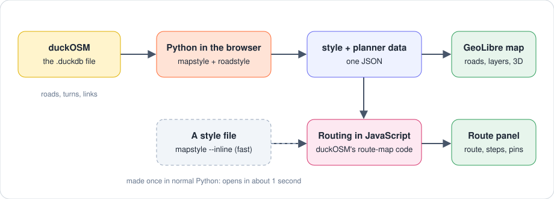

<p align="center">
  <a href="https://github.com/Khoshkhah/roadstyle"></a>
  &nbsp;&nbsp;
  <a href="https://github.com/Khoshkhah/duckOSM"><picture>
    <source media="(prefers-color-scheme: dark)" srcset="img/duckosm-inverse.svg">
    
  </picture></a>
  &nbsp;&nbsp;
  <a href="https://web.geolibre.app"></a>
</p>

<h1 align="center">The guide</h1>

<p align="center"><a href="../README.md">← back to the README</a></p>

**Contents:** [How it works](#how-it-works) · [Route planner](#route-planner) · [Input data](#input-data) · [The Layers panel](#the-layers-panel) · [The dialog](#the-dialog-of-open-a-duckosm-database) · [Speed](#speed) · [Needs](#needs) · [Build and test](#build-and-test)

## How it works

<p align="center"></p>

| Piece | What it does for the plugin |
|---|---|
| **[duckOSM](https://github.com/Khoshkhah/duckOSM)** | Builds the `.duckdb` file from OpenStreetMap: the roads of each mode, the allowed turns, the links between walking and driving, and the order in which roads are drawn. |
| **[mapstyle](https://github.com/Khoshkhah/mapstyle)** | Reads the file and makes the whole map as one style (roads, water, buildings, 3D, crossings…). It also cuts out the data of the route planner. |
| **[roadstyle](https://github.com/Khoshkhah/roadstyle)** | Draws the roads: casings, bridges, tunnels, one-way arrows, street names. |
| **The plugin** | Runs mapstyle and roadstyle in the browser (Python in WebAssembly), draws the result in GeoLibre, and adds the Layers rows, the filters and the route planner. |

## Route planner

**Where it comes from.** The route planner is duckOSM's. `duckosm route-map` makes a web page with a route planner for a database, and this plugin has the same planner inside GeoLibre.
There is no routing server: the routes are found in your browser, from the network that is in the `.duckdb` file.

**What is in the file.** duckOSM keeps, for each mode (driving, walking, cycling):
- the roads, with their length and their travel time (`cost_s`),
- the turns that are allowed (the `edge_graph` table: from one road to the next; one-way streets and turn restrictions are in it),
- and, for **Walk + drive**, the links between the walking network and the driving network (the `mm` tables: where you can get in a car, and what a change costs: 60 seconds by default).

**What the plugin does with it.**
1. `mapstyle` cuts these tables out of the file as compact lists (about 2.3 MB for Monaco). They travel inside the style, in the metadata `roadstyle:planner`.
2. The routing code in JavaScript finds the best route over these lists: a shortest-path search over the turn graph (one search per mode; for Walk + drive, a search over the mode and the phase of the trip).
3. A pin is put on the nearest road. If it is a little off the road, the walk to the road counts: 50 m at 4.5 km/h by default (both can be changed in "Settings and details").
4. The steps ("Turn right onto…", "At the roundabout, take the 2nd exit…") are made from the heading changes along the route, with the rules of the OSRM maneuver model. A turn is only announced at a real junction (three roads or more).
5. The panel shows the result, and the route line is drawn on the map.

**Turn restrictions.** Every part of a route follows the allowed turns of its own mode, also in Walk + drive.

**The same answers as duckOSM.** The page of `duckosm route-map` and the plugin use the same code. In duckOSM's own check, the route in the page was the same as the route of its `route()` and `route_multimodal()` functions for 8 of 8 trips in Monaco.
The plugin does not copy the panel by hand: `tools/make_planner.py` makes `planner/panel.html`, `panel.css` and `planner.js` from duckOSM's `templates/planner.html`, so the two always look the same.

**Using it**
- **Drag the two pins** (A start, B end). The route changes at once. Choose **Walk, Cycle, Drive, Walk + drive**, and **Fastest** or **Shortest**.
- **Walk + drive** starts and ends with a walk, and each change between walking and driving adds 60 s. So it takes more time than **Drive** for the same two pins. With **Shortest** it finds the trip with the fewest metres. That trip can have long walks and take much more time.
- The summary shows the time and the length, with a bar for each leg. A click on a step zooms the map to it. A click on a road keeps its `edge_id` in the panel.
- The route is a row **route** in the Layers panel: switch it off there.
- **Back to the normal map:** close the panel (the × in its header). The pins and the route go, and the map stays as it was. **roadstyle › Route planner** opens the panel again, and the route comes back. **Remove roadstyle layers** removes the whole map.
- **Full screen:** GeoLibre's full screen shows only the map, so the panel becomes a box over the map. The tab "Route planner" hides and shows the box (hiding it also leaves routing mode). When you leave full screen, the panel goes back to the side panel.

**Limits.** The lists are in the page, so the planner works for databases up to 150,000 roads: a bigger database opens without it. Not in the planner: lane advice, exit numbers, spoken directions.

## Input data

| Menu item | Input | How to make it |
|---|---|---|
| **Open a duckOSM database…** | a `.duckdb` file | `pip install duckosm`, then `duckosm build --config <area>.yaml`. Or use the Monaco file above. [duckOSM](https://github.com/Khoshkhah/duckOSM) |
| **Add a roadstyle layer…** | a `style.json` file from your disk (the fast way) or its URL | see below |
| **Style a layer with roadstyle…** | a data layer in GeoLibre and a look (optional) | see below |

The link `https://web.geolibre.app/?roadstyle=<URL of a style.json>` draws a style when GeoLibre starts (the plugin must be active).

**The fast way: make the style file once, with Python.**

```bash
pip install mapstyle
mapstyle monaco.duckdb --inline monaco.json --planner      # 6 seconds; --planner adds the data of the route planner
```

In GeoLibre: **roadstyle › Add a roadstyle layer…**, choose `monaco.json`. The map opens in about **1 second**, also for a big area. Opening the `.duckdb` file
itself makes the same file in the browser, where Python is about 3 times slower: the map is on the screen after about 18 seconds for Monaco, with the street names and arrows added about 10 seconds later (the next time you open the same file, the browser has kept the result).

**A `style.json` with the data inside** (the same file, from Python):

```python
import json
from mapstyle.export import export_inline          # pip install mapstyle
json.dump(export_inline("monaco.duckdb"), open("style.json", "w"))
```

**A `style.json` with vector tiles** (large areas):

```python
import mapstyle
from roadstyle.export import export_style          # pip install roadstyle mapbox-vector-tile
export_style(mapstyle.load_roads("monaco.duckdb"), "out", base_url="https://example.com/out")
```

Put the files on a server with **https** and **CORS** (GitHub Pages works). GeoLibre cannot read from `http://localhost`.

**A look for a data layer:** `rs.export_look("look.json")` writes a look. The layer needs the columns `highway`, `oneway`, `tunnel`, `bridge`,
`casing_level` and `fill_level` (duckOSM's `duckosm export-gis --format geoparquet` writes them).

## The Layers panel

Each map has three folders. The first is on top, and it is drawn last.

| Folder | Rows |
|---|---|
| **Features** | buildings 3D, crossings, traffic signals, bus and train stations, parking signs, bicycle |
| **Roads** | one row for each road type (bridges, tunnels, motorway … footway), then raceway and other ways |
| **Background** | paved areas, buildings, railways, parking, platforms, waterways, water, land cover |

- The check box of a folder switches all its rows. The **Opacity** slider fades them. The slider of a row fades that row.
- A click on a road, a raceway or another way opens its popup.
- Crossings and traffic signals show from zoom 16.

## The dialog of "Open a duckOSM database"

| Choice | Values |
|---|---|
| Roads in front | all modes, driving, walking, cycling |
| Colours | OpenStreetMap (default), Google, Grey, roadstyle default |
| Footpaths and cycleways | Google, OpenStreetMap, Komoot, CyclOSM |
| Ocean polygon | off (default: GeoLibre's own map shows the sea), on |
| 3D bridge decks | off (default), on |
| Route planner | on (default), off |

## Speed

Monaco (13,000 roads) in the real GeoLibre. Python in the browser is about three times slower than normal Python, and most of the time is roadstyle's own work (the street names and the arrows are two thirds of it).

| | Time |
|---|---|
| First open from the `.duckdb` file: the map is on the screen | about 18 s (6 s to start Python, 10 s to make the map) |
| The street names and arrows are added | about 10 s later, in the background |
| The same file again, with the same choices (the browser keeps the map) | about 3 s |
| A style file made with `mapstyle --inline` | under 1 s |

Python starts when the dialog opens, and by itself a few seconds after GeoLibre opens if you used the plugin before.

## Needs

- A browser with enough memory: the `.duckdb` file is read into memory twice.
- The network: the plugin loads Pyodide and its packages (numpy, pandas, shapely, geopandas, DuckDB and a few more) from `cdn.jsdelivr.net`, a pinned version (Pyodide 314.0.7).
  Nothing is installed from PyPI at run time: the roadstyle, mapstyle and branca code is inside the plugin (roadstyle 0.24.2, mapstyle 0.12.0, branca 0.8.2). The code of the zip is
  minified; the readable source is in this repository.

## Build and test

```bash
pip install roadstyle mapstyle
python build.py                                    # makes dist/roadstyle-geolibre.zip
python -m pytest tests -q -m "not slow"            # a few seconds, in a stand-in for GeoLibre
python tests/e2e_geolibre.py monaco.duckdb         # the real web.geolibre.app, with a database (minutes)
python tests/e2e_inputs.py monaco.duckdb           # the real web.geolibre.app, with a style URL and a tiles export
```

Change `version` in `plugin.json` and in `index.js` together (a test checks that they are equal). GeoLibre trusts a plugin by the hash of
its files: after a change, remove the plugin and install the new `.zip`.

Design: `docs/design/style_export.md` in the [roadstyle repo](https://github.com/Khoshkhah/roadstyle).

The GeoLibre logo is the icon [docs/assets/geolibre-icon.png](https://github.com/opengeos/GeoLibre/blob/9cf193094e6575bfd152ec020345a8e69b75290c/docs/assets/geolibre-icon.png) of [GeoLibre](https://github.com/opengeos/geolibre) (MIT license).
